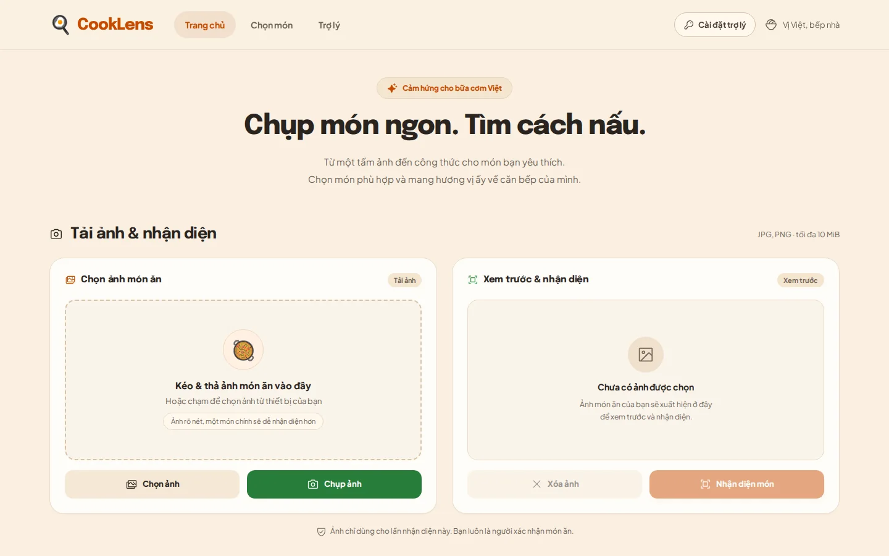
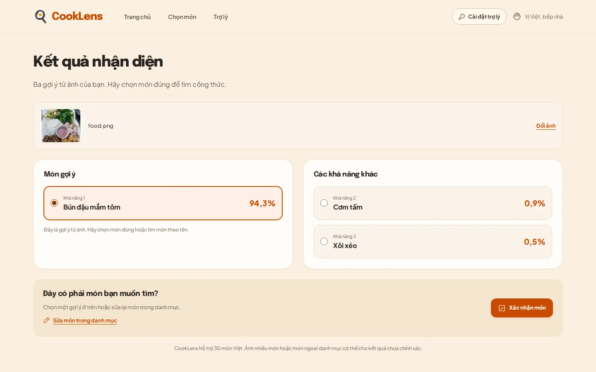
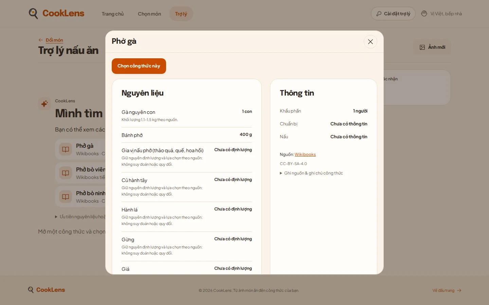
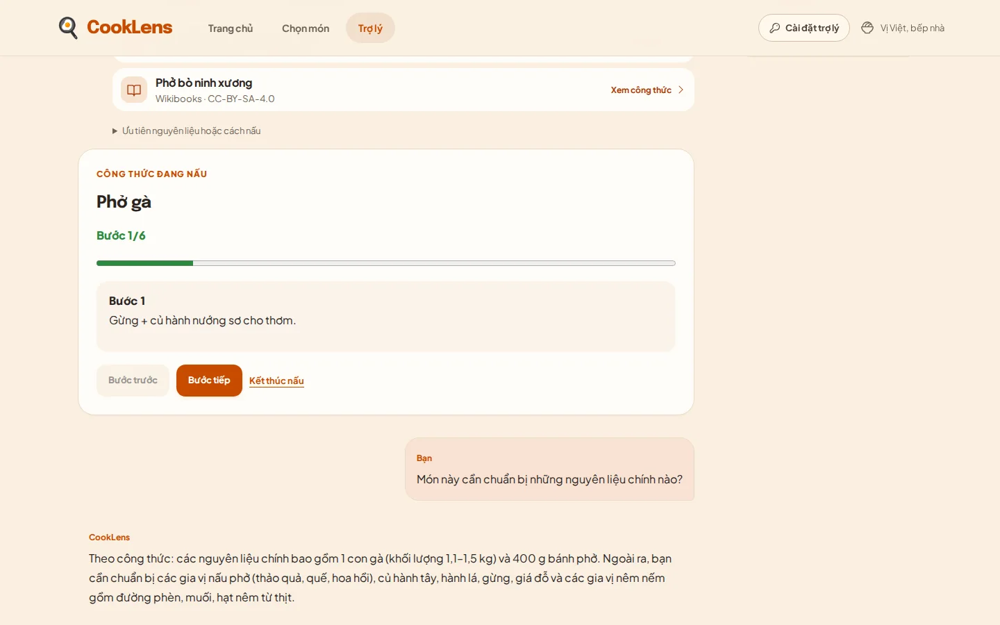
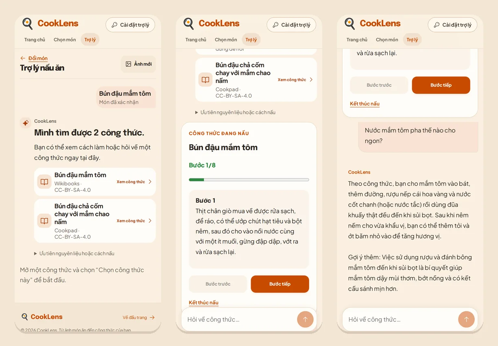
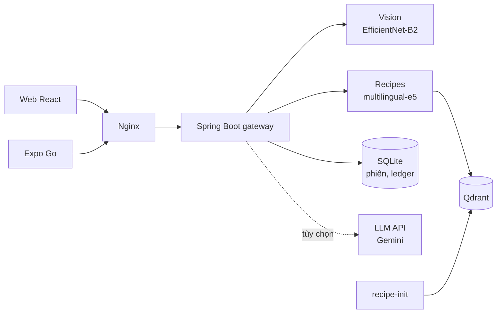

<h1 align="center">🍳 CookLens</h1>

<p align="center">
  <b>Từ một tấm ảnh món Việt đến công thức có nguồn và trợ lý nấu từng bước.</b>
</p>

<p align="center">
  <a href="https://github.com/tung51652-alt/Cooking-assistant/releases/latest"></a>
  
  
  
  
</p>

<p align="center">
  
</p>

## Mục lục

- [Giới thiệu](#giới-thiệu)
- [Tính năng](#tính-năng)
- [Hình ảnh sản phẩm](#hình-ảnh-sản-phẩm)
- [Kiến trúc](#kiến-trúc)
- [Kết quả đánh giá](#kết-quả-đánh-giá)
- [Chạy nhanh](#chạy-nhanh)
- [Cấu trúc mã nguồn](#cấu-trúc-mã-nguồn)
- [Phát triển và kiểm thử](#phát-triển-và-kiểm-thử)
- [Giới hạn](#giới-hạn)
- [Tài liệu](#tài-liệu)
- [Dữ liệu và giấy phép](#dữ-liệu-và-giấy-phép)

## Giới thiệu

Người nấu ăn thường gặp một món ngon qua ảnh nhưng không biết tên món hoặc cách làm.
CookLens giải quyết bài toán theo ba bước, mỗi bước có kiểm soát rõ ràng:

1. **Nhận diện** — mô hình EfficientNet-B2 gợi ý ba món trong danh mục 30 món Việt; ảnh mờ hoặc không đủ tin cậy bị từ chối thay vì đoán bừa.
2. **Xác nhận và tra cứu** — người dùng luôn xác nhận món; hệ thống tìm công thức bằng tìm kiếm ngữ nghĩa chỉ trong món đã xác nhận, kèm nguồn và giấy phép.
3. **Trợ lý nấu ăn** — hỏi đáp dựa trên công thức đang chọn qua LLM (mặc định Gemini 3.5 Flash-Lite) và điều khiển từng bước nấu bằng logic ứng dụng; phiên được lưu để quay lại sau.

Nguyên tắc thiết kế: không bịa dữ liệu (thiếu thì để trống), không để model tự thay đổi trạng thái nấu, và mọi phần ảnh/công thức vẫn hoạt động khi LLM không sẵn sàng.

## Tính năng

| Nhóm | Chức năng |
| --- | --- |
| 📷 Nhận diện ảnh | Top-3 kèm độ tin cậy; chặn ảnh mờ và ảnh có điểm cao nhất dưới 65%; chọn món theo tên khi không có ảnh |
| 📚 Công thức | 90 công thức tiếng Việt cho 30 món; tối đa ba kết quả, lọc theo nguyên liệu hoặc cách nấu; ghi rõ nguồn, giấy phép và công thức do AI biên soạn |
| 💬 Trợ lý | Hỏi đáp theo công thức và bước hiện tại; phân biệt dữ kiện công thức với gợi ý thêm; người dùng có thể dùng API key riêng trên web và Expo |
| 👩‍🍳 Nấu từng bước | Bắt đầu, bước tiếp/trước, kết thúc; tiến độ và hội thoại khôi phục sau khi tải lại trang hoặc khởi động lại server |
| 📱 Đa nền tảng | Web responsive và app Expo Go dùng chung API và client TypeScript |
| 🛡️ Vận hành | Một lệnh `docker compose up`; model, corpus và vector nằm sẵn trong image; giới hạn request, ngân sách LLM, chặn endpoint nội bộ và rollback dữ liệu |

## Hình ảnh sản phẩm

<table>
  <tr>
    <td width="50%"></td>
    <td width="50%"></td>
  </tr>
  <tr>
    <td align="center"><b>Nhận diện</b> — ba gợi ý, người dùng xác nhận món</td>
    <td align="center"><b>Công thức</b> — nguyên liệu, bước làm, nguồn và giấy phép</td>
  </tr>
  <tr>
    <td colspan="2"></td>
  </tr>
  <tr>
    <td colspan="2" align="center"><b>Trợ lý nấu ăn</b> — tiến độ từng bước và hỏi đáp bám sát công thức</td>
  </tr>
  <tr>
    <td colspan="2"></td>
  </tr>
  <tr>
    <td colspan="2" align="center"><b>Trên điện thoại</b> — danh sách công thức, nấu từng bước và hỏi đáp</td>
  </tr>
</table>

## Kiến trúc



| Thành phần | Công nghệ | Vai trò |
| --- | --- | --- |
| `frontend` | React 19, Vite, TypeScript, Nginx | Giao diện web và proxy API cùng origin |
| `mobile` | Expo SDK 58, React Native 0.88 | App Expo Go dùng chung client API |
| `backend` | Java 21, Spring Boot 3.5, SQLite | Public API, validation, phiên nấu, điều phối AI và LLM |
| `vision` | PyTorch, FastAPI | Kiểm tra ảnh, EfficientNet-B2, trả Top-3 |
| `recipes` | multilingual-e5-small, FastAPI | Embed truy vấn, lọc theo món, tìm và đọc công thức |
| `qdrant` | Qdrant 1.19 | Lưu vector và metadata công thức |

Chỉ frontend mở cổng; AI và Qdrant nằm trong mạng nội bộ, riêng backend có đường ra Internet để gọi LLM.
Chi tiết ở [kiến trúc](docs/architecture.md) và [API contract](docs/contracts/mvp-v1.md).

## Kết quả đánh giá

| Hạng mục | Tập đánh giá | Kết quả |
| --- | --- | --- |
| Nhận diện | 5.004 ảnh test, 30 lớp | Top-3 **96,08%** · Top-1 87,57% · Macro F1 0,877 |
| Tìm công thức (corpus v3) | 259 truy vấn, 30 món | Hit@1 **93,05%** · Hit@3 100% · MRR 0,965 · không lẫn món |
| Độ trễ API | 100 mẫu/API, CPU | P95 nhận diện 0,16 s · tìm kiếm 0,09 s |
| Ngưỡng 65% | 240 ảnh món, 14 ảnh ngoài danh mục | Chặn 14/14 ảnh ngoài danh mục, 73,8% ảnh món có gợi ý đúng |
| Trợ lý (Gemini 3.5 Flash-Lite) | 50 câu cố định | 50/50 đúng trạng thái · p95 1,51 s · output TB 59 token |

Cách đo, cấu hình máy và giới hạn diễn giải ở [nghiệm thu](docs/acceptance.md).

## Chạy nhanh

Yêu cầu: Docker chạy Linux containers, Compose ≥ 2.24.4. Không cần cài Python, Java hay Node.

```sh
git clone https://github.com/tung51652-alt/Cooking-assistant.git
cd Cooking-assistant
cp .env.example .env        # tùy chọn: điền LLM_API_KEY để bật hỏi đáp
docker compose up -d --wait
```

Mở **http://localhost:8080/**.
Lần đầu Docker tải image (đã gồm model và dữ liệu) rồi nạp chỉ mục công thức.

- **Hỏi đáp:** điền Google AI Studio key vào `LLM_API_KEY` trong `.env`, rồi `docker compose up -d --force-recreate backend`.
  Thiếu key, nhận diện, công thức và nút bước nấu vẫn hoạt động.
- **Expo Go:** đặt `HOST_BIND` là IP LAN của máy chạy Docker, làm theo [hướng dẫn mobile](mobile/README.md).
- **Dừng, nâng cấp, backup:** xem [triển khai](docs/deployment.md).

## Cấu trúc mã nguồn

```text
Cooking-assistant/
├── ai/
│   ├── cv/          # Huấn luyện (notebook) và service nhận diện
│   └── rag/         # Embedding, nạp chỉ mục, tìm kiếm và đánh giá
├── backend/         # Spring Boot gateway, phiên trợ lý, adapter LLM
├── frontend/        # Web React + Playwright tests
├── mobile/          # App Expo Go
├── packages/
│   └── cooklens-api/  # Client và type API dùng chung web/mobile
├── data/            # Taxonomy 30 món, corpus công thức, validator
├── deploy/          # Script build, smoke, đánh giá và phát hành
├── docs/            # Tài liệu sản phẩm, kiến trúc, kiểm thử, nghiệm thu
└── compose.yaml     # Một Compose cho toàn bộ hệ thống
```

## Phát triển và kiểm thử

| Lớp | Lệnh chính |
| --- | --- |
| Backend | `mvn -B -f backend/pom.xml test` |
| Web | `npm --prefix frontend run build` · `npm --prefix frontend run test:e2e` |
| Mobile | `npm --prefix mobile run test:assistant` · `npm --prefix mobile run typecheck` |
| Client dùng chung | `node --experimental-strip-types --test packages/cooklens-api/client.test.mjs` |
| Dữ liệu và phát hành | `python3 -m unittest discover -s data/tests` · `python3 -m unittest discover -s deploy/tests` |
| Lint/format | `ruff check ai data deploy` · `npm --prefix frontend run lint` · `mvn -f backend/pom.xml spotless:check` |

Build từ source ở [phát triển](docs/development.md); toàn bộ lớp kiểm thử, tiêu chí đạt và bộ đánh giá trợ lý ở [kiểm thử](docs/testing.md).
Quy ước làm việc và Git ở [WORKFLOW](docs/WORKFLOW.md).

## Giới hạn

- Chỉ nhận diện 30 món; ảnh nhiều món hoặc ngoài danh mục có thể bị từ chối hoặc gợi ý sai, người dùng luôn là người xác nhận.
- Ngưỡng 65% đôi khi chặn cả ảnh món hợp lệ; khi đó chọn món theo tên.
- Gemini có thể bị giới hạn tần suất hoặc phản hồi chậm (mỗi câu chờ tối đa 8 s); trợ lý không thay thế tư vấn dị ứng hay an toàn thực phẩm.
- Android thật, iOS và đánh giá chất lượng câu trả lời bởi người chưa được nghiệm thu đầy đủ.

Danh sách đầy đủ ở [sản phẩm](docs/product.md#giới-hạn) và các [issue đang mở](https://github.com/tung51652-alt/Cooking-assistant/issues).

## Tài liệu

| Chủ đề | Tài liệu |
| --- | --- |
| Mục lục | [docs/README.md](docs/README.md) |
| Phạm vi và giới hạn | [Sản phẩm](docs/product.md) |
| Service, dữ liệu, trợ lý | [Kiến trúc](docs/architecture.md) · [API contract](docs/contracts/mvp-v1.md) |
| Build và đóng góp | [Phát triển](docs/development.md) · [Workflow](docs/WORKFLOW.md) |
| Vận hành và phát hành | [Triển khai](docs/deployment.md) |
| Kiểm thử và số đo | [Kiểm thử](docs/testing.md) · [Nghiệm thu](docs/acceptance.md) |
| Việc đang mở | [Kế hoạch](docs/plan/README.md) · [CHANGELOG](CHANGELOG.md) |

## Dữ liệu và giấy phép

- Ảnh huấn luyện từ [30VNFoods](https://huggingface.co/datasets/vuongnhathien/30VNFoods); quyền dữ liệu upstream ghi ở [nghiệm thu](docs/acceptance.md#giới-hạn-diễn-giải).
- Công thức từ Wikibooks và các nguồn tiếng Việt khác, bộ sưu tập theo CC BY-SA 4.0, giấy phép từng bản ghi ở [corpus](data/recipes/README.md).
- Model embedding [multilingual-e5-small](deploy/artifacts/embedding-model-v1.md), font và icon có notices đi kèm trong image và gói phát hành.
